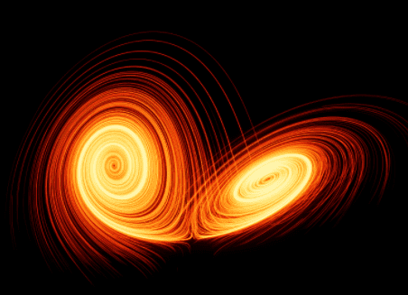

*non solus*

# About Me

Vincent has been interested in AI and yoga since childhood, playing with k'nex making small robots and other models while sitting in Sukhasana. His trip to PhD was not obvious although also not unexpected, definitly met with difficulty however at times punching below his weight-class. 

# Details
I study AI.
I do yoga.
I play guitar.
I like games (mostly counter-strike).

Erdos number: 4

Krishnamacharya number: 3

# Travels
- Agen, France
- Kutaisi, Georgia
- Bolognia & Ravenna, Italy
- Trois Riviere & Sherbrook, Canada 
- Vienna, Austria
- Leuven, Belgium
- Galway, Ireland
- Haifa, Israel
- --
- other trips pre univerisity

# Education
## University
- 2022-now: PhD AI/CS ICR-CLAIM group, University Luxembourg   
  - [Phd Dissertation: Principled Dual-Scale Detachment for IHiBO.](vjdw_phd_dissertation.pdf)
  - [Timeline of AI](Timeline_of_AI.pdf)
- 2019-2021 MSc Artificial Intelligence, University of Utrecht
  - [Thesis: Probabilistic Deontic Logics](Thesis_ProbabilisticDeonticLogics.pdf)
  - [Vicious Delicious Bias](paper.pdf)
- 2015-2019 BSc Artificial Intelligence, Rijks University of Groningen
  - [Thesis: Predicting in-vivo enzyme dynamics using a neural ordinary differential equation network.](bsc_thesis.pdf)
  - [Why is reality here or there?]()
- 2013-2015 Mathematics, University Leiden
  - Infinite dimensional sphere

## Yoga
- Introduction to second series by Marie of Ashtanga yoga Luxembourg
- 26th July - 1st August 2026: Larugar Glaser Retreat at Ashtanga France with David Fredriksson
- 2026: Black Lotus: Into the depths
- 12-26 jul 2025: 108h TT Navakaraṇa Vinyāsa Teacher Training; M1 Grounding and Opening, by Dario Calvaruso, Bologna
- Yoga retreat Italy Exhale-HouseOfOm
- 24-25 feb 2024: Navakaraṇa Vinyāsa Immersion Workshop, by Dario Calvaruso, Exhale Yoga Luxembourg
- 26-28 jan 2024: 25H TT Rocket Yoga Teacher Training, by David Cabezas Sanches, Exhale Yoga Luxembourg
- 10-12 nov 2023: 25H TT Rocket Yoga Teacher Training, by David Cabezas Sanches, Exhale Yoga Luxembourg
- 22    jan 2023: Wim Hoff Method Workshop, by B-YOU, Exhale Yoga Luxembourg
- 2018: Ashtanga Yoga Immersion, Bhumi Yoga Groningen
- 2013: first sun salutation

# Contributions
## 2026
- PhD dissertation: Dual Scale detachement for IHiBO; the MAS effect. - Vincent J. de Wit
## 2025
- Dual Scale Detachment - Vincent de Wit, Aleks Knoks and Leendert van der Torre
  - Conference paper: JELIA 2025, Kutaisi Georgia
- Towards Dual Scale Detachment - Vincent de Wit, Aleks Knoks and Leendert van der Torre	
  - Conference poster: DEON 2025, Vienna Austria
## 2024
- Balancing Normative Reasons for the Intelligent Human-Input-Based Blockchain Oracle (IHiBO) - de Wit, V., Yu, L., Najjar, A., Markovich, R.
  - Workshop paper: CALM 2024, Kyoto Japan, November 18-24
- Applying the Theory of Balancing Reasons for Documenting Fund Management Decisions on the Ethereum Network - Vincent De Wit
  - DILLAN conference, Luxembourg Luxembourg, October 17, 18
- A Principle-based Analysis for Numerical Balancing - A Knoks, M Shao, L van der Torre, V de Wit, L Yu
  - Workshop paper: LNGAI 2024
- DILLAN text, eu workshop, Regulating Tri-Logues
- DILLAN text, DILLAN seminar, [AI history](Timeline_of_AI.pdf)
## 2023
- Reasons in Weighted Argumentation Graphs - David Streit, Vincent de Wit, Aleks Knoks
  - Conference paper: LORI 2023: 251-259
- Rule rather than Exception: Defeasible Probabilistic Dyadic Deontic Logic - Vincent de Wit
  - [Conference poster: DEON 2023: 343-345](de_WIT_Defeasible_Probabilistic_Dyadic_Deontic_Logic.pdf)
  - [Conference Websits](https://oraprdnt.uqtr.uquebec.ca/portail/gscw031?owa_no_site=7185)
  - [video](https://oraprdnt.uqtr.uquebec.ca/portail/docs/GSC7185/O0005324072_6_Poster_ReasoningWithNormsAndUncertainty.webm)
- Probabilistic Deontic Logics for Reasoning about Uncertain Norms - Vincent de Wit, Dragan Doder, John-Jules Ch. Meyer
  - Journal paper: FLAP 10(2): 193-220 (2023)
## 2022
## 2023
- A Probabilistic Deontic Logic - Vincent de Wit, Dragan Doder, John-Jules Ch. Meyer
  - Conference paper: ECSQARU 2021: 616-628
  - [conference website](https://ecsqaru.utia.cas.cz)
  - [video](https://www.youtube.com/live/Hh944jtZoHE?si=m1ZsTVoZuJbxXtVy&t=1680)

# Teaching
## 2025
- Intelligent Systems 2 (4 ects); Teaching Assistant
## 2024
- Intelligent Systems 2 (4 ects); Teaching Assistant
- Discrete Mathematics 1 (5 ects); Teaching Assistant
## 2023 
- Intelligent Systems 2 (4 ects); Teaching Assistant
- Discrete Mathematics 1 (5 ects); Teaching Assistant
## 2022
- Discrete Mathematics 1 (5 ects); Teaching Assistant

# Miscellaneous

- Conways game of life: https://www.youtube.com/watch?v=C2vgICfQawE
- the defuse kit paradox: don't be a loser buy a defuser vs. are you expecting be a loser when you buy a defuser?
- Agent Orchestration mess: https://www.youtube.com/watch?v=l5wvqKcqL7c
- favourite algorithm: https://en.wikipedia.org/wiki/Cannon%27s_algorithm
  - maybe dijkstra's
- still confused about the axiom of choice implying 1+1=3
- Carl Jung’s Hammer and Anvil Metaphor

*The ball is round (and rolls).*
